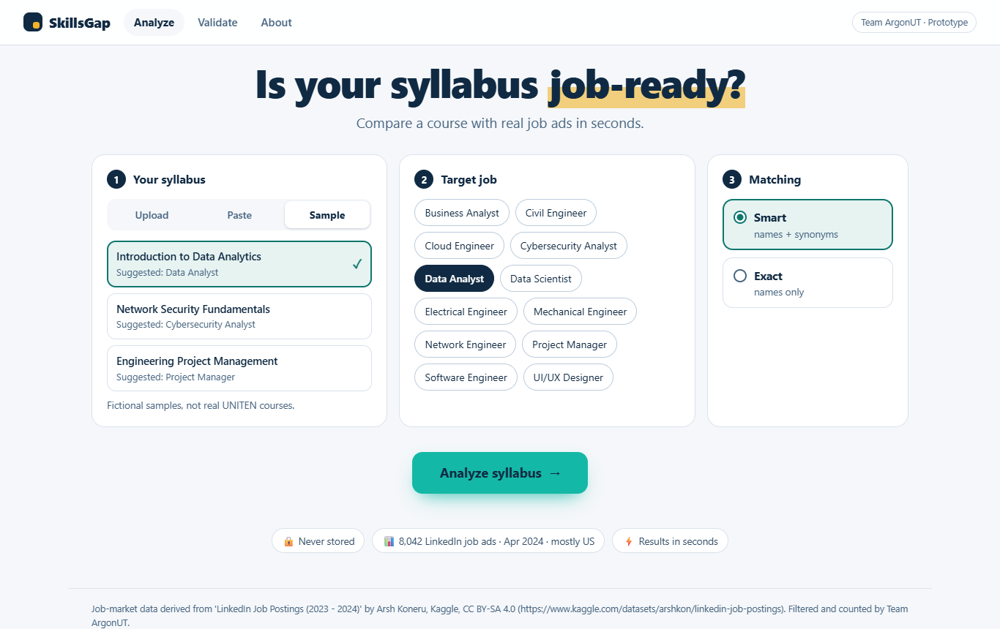
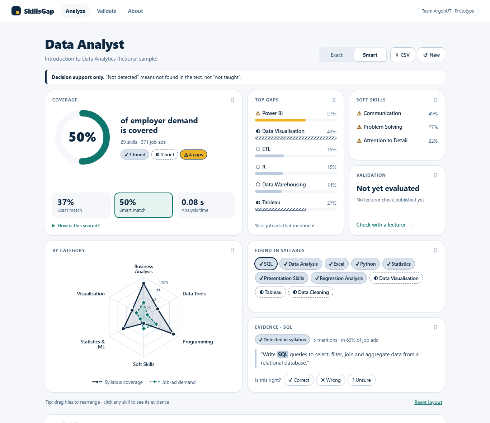

# SkillsGap

**Is your syllabus job-ready?** SkillsGap compares a university course syllabus with the skills that job ads mention, and gives lecturers a subject-level checklist of *potential* skill gaps, with the evidence behind every result.

Team **ArgonUT** · HackSpire Lumina, UNITEN · Prototype





*Screenshots show the app's real output for a fictional sample syllabus (not a real UNITEN course).*

---

## What it does

1. **Add a syllabus:** upload a PDF or Word file, paste the text, or pick one of 3 fictional samples.
2. **Choose a target job:** 12 roles, such as Data Analyst, Cybersecurity Analyst or Civil Engineer.
3. **See the results:** a coverage score, the potential gaps, a chart by skill category, the skills found, and the sentence from the syllabus behind each one. Tiles can be dragged to rearrange.
4. **Validate:** a lecturer marks each skill in a template, and the app reports precision, recall and F1 for both matching methods.

Results are **decision support only**. "Not detected" means the skill's words were not found in the text. It does not mean the skill is not taught.

## Status (read this first)

- **Not yet validated.** No comparison with lecturers on real syllabi has been published yet, so there are **no accuracy figures**. The Validate page is the tool for doing this.
- **The scoring formulas are placeholders** (see [Method](#method)). The ML team may replace them.
- **The job data is mostly from the US**, from April 2024. It contains no Malaysian postings (see [Data](#data)).

---

## Quick start (Windows PowerShell, Python 3.12)

From the folder containing `server.py`:

```powershell
py -3.12 -m venv .venv               # once
.\.venv\Scripts\Activate.ps1         # every time
pip install -r requirements.txt      # once
uvicorn server:app --reload
```

Open **http://127.0.0.1:8000**. Stop with **Ctrl+C**.
If PowerShell blocks activation, run `Set-ExecutionPolicy -Scope CurrentUser RemoteSigned` once.

**Tests:** `python -m pytest -q` → expected `60 passed`.

**Deploy (optional):** the repo includes `render.yaml` and `.python-version` for a free Render Blueprint (New → Blueprint → select the repo). Health check: `/api/health`. Free services sleep after 15 minutes idle and take about a minute to wake.

## Method

Dictionary-based matching, **not AI**. Every result shows its evidence.

1. **Extract text** from PDF/Word (pdfplumber, python-docx) or pasted input. Scanned PDFs are rejected.
2. **Look up the role's skills:** 28–30 per role, from a dictionary of 244 (each with a category and synonyms).
3. **Match whole words or phrases:**
   - **Exact (Level 1):** skill name only.
   - **Smart (Level 2):** name plus synonyms (e.g. "Splunk" for SIEM), using the same rules the data team used to count job ads.
   - **Short ambiguous names** (R, C, Go, Excel, SAS, React, Sketch, Spark, ML, IR, IDS, IPS) match case-sensitively as stand-alone words. R, C and Go also need a nearby context word such as "programming" or "Python".
4. **Status** by mentions: 2+ = *Detected*; 1 = *Briefly mentioned*; 0 = *Not detected*. Not detected **and** in at least 20% of the role's job ads = *Potential skill gap*.

**Scores (placeholders).** Demand = share (0–1) of the role's job ads mentioning the skill.

```
coverage weight   = 1 (detected), 0.5 (brief), 0 (not detected)
gap score         = demand × (1 − coverage weight)
coverage score    = 100 × sum(demand × coverage weight) ÷ sum(demand)
category coverage = coverage score using only that category's skills
category demand   = 100 × average demand of that category's skills
```

`analysis/matcher.py` can be replaced without touching the web page, as long as `analyze()` keeps the output format in [docs/INTERFACE.md](docs/INTERFACE.md). The server validates every result against it.

### Limitations

- **Missed skills:** a syllabus can teach a skill without naming it.
- **False detections:** a word may appear in an unrelated context (e.g. a reading list).
- **No teaching depth:** text cannot show how well a topic is taught.
- **Dictionary only:** skills outside the dictionary are never found.
- **Equal weight:** every mention counts the same wherever it appears (section-aware weighting is planned).

## Validation

**Pilot workflow:** analyse a real syllabus → download the template on the Validate page → a lecturer fills `covered`, `brief` or `not_covered` per skill (ideally before seeing results) → upload it to see precision, recall and F1 for Exact vs Smart, plus every disagreement with evidence.

To publish pilot totals in the app, record them in `data/validation_results.json`. It then shows them as "Pilot, small sample, not generalisable"; until then, "Not yet evaluated".

By default "covered" includes *Briefly mentioned* (a switch treats "brief" as not covered on both sides). Fewer than 10 compared skills triggers a small-sample warning.

- **Precision** = correct detections ÷ all app detections
- **Recall** = correct detections ÷ all skills the lecturer marks covered
- **F1** = 2 × precision × recall ÷ (precision + recall)

**Worked example:** app detects 14, 10 correct, lecturer says 12 covered → TP 10, FP 4, FN 2 → precision 0.714, recall 0.833, F1 = 20 ÷ 26 = 0.769. Covered by `tests/test_validation.py::test_worked_example_14_detected_10_correct_12_covered`.

## Data

| | |
|---|---|
| Source | [LinkedIn Job Postings (2023 - 2024)](https://www.kaggle.com/datasets/arshkon/linkedin-job-postings), Arsh Koneru, Kaggle |
| Licence | CC BY-SA 4.0 |
| Postings used | 8,042, listed April 2024 (public dataset, no scraping) |
| Region | Global, almost all US. **No Malaysian postings.** |
| Roles | 12, assigned from job-title keywords |

**Attribution (required by the licence):** Job-market data derived from 'LinkedIn Job Postings (2023 - 2024)' by Arsh Koneru, Kaggle, CC BY-SA 4.0 (https://www.kaggle.com/datasets/arshkon/linkedin-job-postings). Filtered and counted by Team ArgonUT.

Derived files in `data/` are shared under **CC BY-SA 4.0**. Details (title mapping, steps, spot check, known biases): [data/DATA_README.md](data/DATA_README.md). The raw dataset is not in the repo. To rebuild, download `postings.csv` and run from the project root:

```powershell
python data/prepare_data.py --raw postings.csv
```

**Known limits:** a job-ad mention is not always a requirement; soft skills (e.g. "collaboration") likely score above true demand; role sizes are uneven (Software Engineer 2,442 ads vs UI/UX Designer 226).

## Privacy and responsible use

- **Nothing is stored.** Syllabi are processed in memory, never written to disk or logged. Results and answers stay in the browser tab.
- **People decide.** The tool makes no curriculum or accreditation judgement.
- **No real syllabi in the repo.** `.gitignore` blocks `.pdf` and `.docx`; the 3 samples are fictional.
- **Security:** no third-party resources (enforced by CSP); syllabus and CSV text always rendered as plain text; requests over 8 MB rejected; errors show short messages only; downloaded CSV cells cannot run as formulas.

## Project structure

```
server.py        FastAPI server: JSON API + serves web/
web/             index.html, css/styles.css, js/*.js (no build step)
analysis/        matcher.py, skill_rules.py, validation.py, contract.py
utils/           text_extraction.py, data_loading.py, samples.py
data/            job-market data (read-only, CC BY-SA 4.0)
samples/         3 fictional syllabi
tests/           60 pytest tests
docs/            INTERFACE.md, screenshots/
render.yaml, .python-version   optional Render deployment
PROJECT_LOG.md   decisions, milestones, known issues
```

| Endpoint | Purpose |
|---|---|
| `GET /api/health` | Health check |
| `GET /api/meta` | Roles, samples, data source, pilot status |
| `POST /api/analyze` | Analyse a syllabus (Exact and Smart results) |
| `POST /api/validate` | Compare results with a lecturer's CSV |

## AI assistance and credits

- **AI assistance:** an AI coding assistant (Kiro) wrote most of the code, tests and docs under the team's direction; the team reviewed and tested the results. The team confirmed AI assistance is allowed in this competition.
- **Data:** "LinkedIn Job Postings (2023 - 2024)" by Arsh Koneru (Kaggle, CC BY-SA 4.0). Filtering, role mapping, dictionary and counts by the ArgonUT data team.
- **Draggable tile grid:** `web/js/grid.js` is a plain-JavaScript port of the team's "Draggable Widget Grid" reference component (React + Motion).
- **Libraries:** FastAPI, Uvicorn, pandas, pdfplumber, python-docx, pytest.
